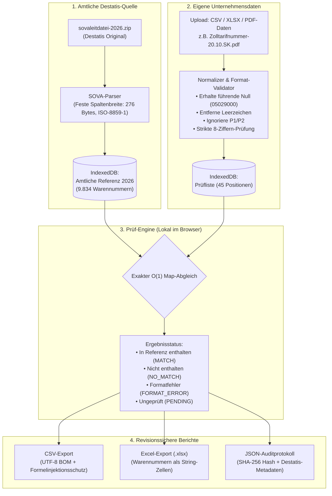
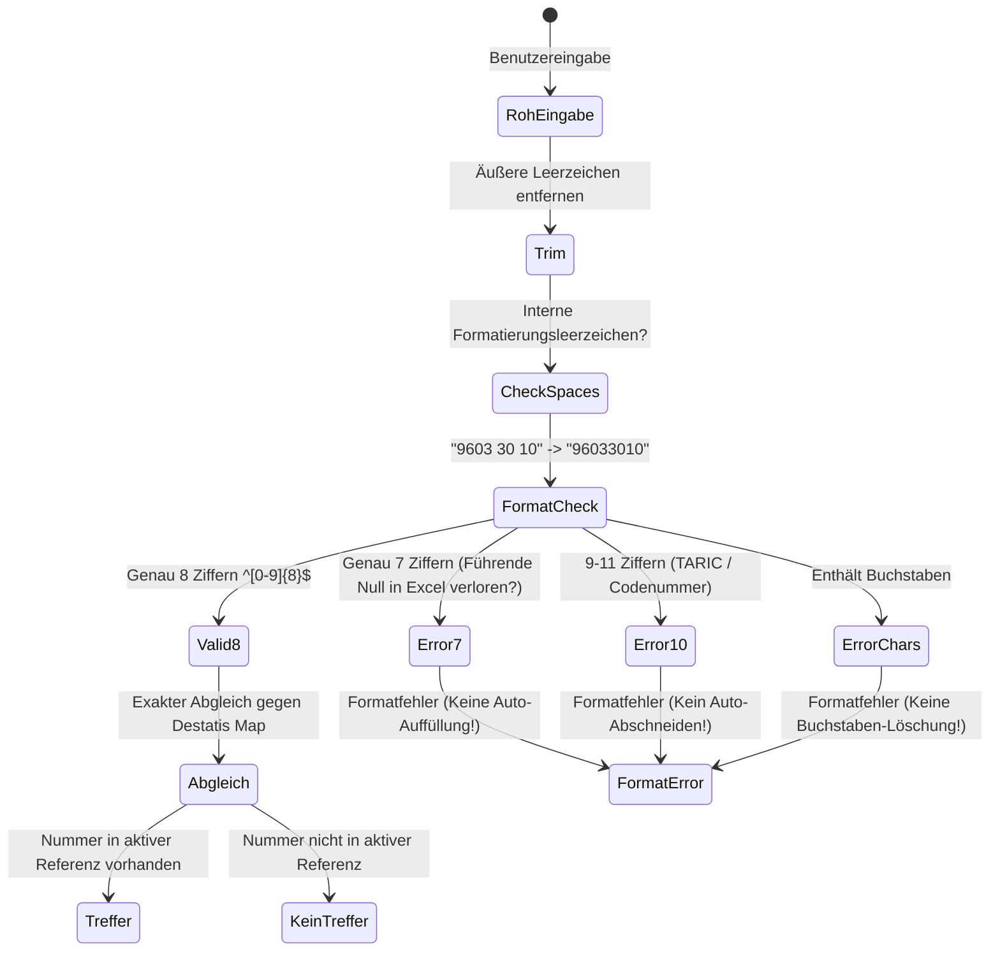

# Warennummern-Checker 🚀

> **Lokale Offline-Prüfung achtstelliger deutscher Warennummern (Zolltarifnummern) gegen die amtliche Sova-Leitdatei des Statistischen Bundesamtes (Destatis).**

---

## ⚠️ 1. Fachliche Grenzen & Rechtlicher Hinweis

Die Anwendung beantwortet **ausschließlich** die folgende fachliche Fragestellung:

> **„Ist diese achtstellige Warennummer in der importierten amtlichen Referenzausgabe von Destatis enthalten?“**

### Was diese Anwendung ausdrücklich NICHT prüft:
- ❌ **Keine zolltarifliche Einreihung:** Es wird **nicht** geprüft, ob die Nummer inhaltlich zum tatsächlichen Produkt passt.
- ❌ **Kein präferenzieller Ursprung:** Keine Prüfung von Ursprungsregeln, Freihandelsabkommen oder Präferenzberechtigungen.
- ❌ **Keine Zollsätze:** Keine Ermittlung von Drittlandszöllen, Antidumpingzöllen oder Einfuhrumsatzsteuersätzen.
- ❌ **Keine Einfuhr- oder Ausfuhrbeschränkungen:** Keine Prüfung von Embargos, Genehmigungspflichten oder Überwachungsmeldungen.
- ❌ **Keine Zusatzcodes:** Keine Prüfung von TARIC-, Meursing- oder nationalen Zusatzcodes.
- ❌ **Keine Rechtsverbindlichkeit:** Die Ergebnisse stellen **keine** verbindliche Zolltarifauskunft (vZTA), keine zollamtliche Freigabe und keine Rechtsberatung dar.

> **Wichtiger Hinweis zu P1 und P2:**  
> Die in Warenaufstellungen häufig auftretenden Kürzel **P1** und **P2** sind reine Personenkennzeichnungen der bearbeitenden Mitarbeiter. Sie sind für die warentechnische Prüfung irrelevant und lösen keinerlei Prüflogik aus.

---

## 2. Architektur & Datenfluss

Sämtliche Datenverarbeitung findet **zu 100 % lokal im Browser des Nutzers** statt. Es gibt kein Server-Backend, keine Datenbank auf einem Fremdserver, keine externen APIs, keine Telemetrie und keine KI-Cloud-Dienste.



---

## 3. Amtliche Datensatzbeschreibung (Destatis)

Die Anwendung implementiert exakt die offizielle Datensatzbeschreibung des Statistischen Bundesamtes für die **Sova-Leitdatei**:

- **Offizielle Quelle:** [Destatis Außenhandel Sova-Leitdatei](https://www.destatis.de/DE/Methoden/Klassifikationen/Aussenhandel/sova-leitdatei.html)
- **Dateiaufbau:** Text mit fester Satzlänge (**276 Bytes pro Datensatz**)
- **Zeichenkodierung:** `ISO-8859-1` (Latin-1 / Windows-1252) für korrekte deutsche Umlaute (z.B. *Färsen*, *Kühe*)
- **Feldstruktur (1-basiert laut Destatis):**
  - **EF 01 (Stelle 1 bis 8, 8 Zeichen, ALN):** Statistische Warennummer (`^[0-9]{8}$`)
  - **EF 02 (Stelle 9 bis 10, 2 Zeichen, ALN):** Leer
  - **EF 03 (Stelle 11 bis 258, 248 Zeichen, ALN):** Selbsterläuternde Warenbeschreibung
  - **EF 04 (Stelle 259 bis 274, 16 Zeichen, ALN):** Besondere Maßeinheit (Abkürzung)
  - **EF 05 (Stelle 275 bis 276, 2 Zeichen, ALN):** Besondere Maßeinheit (numerischer Code)

---

## 4. Normalisierung & Umgang mit Warennummern

Warennummern sind **Kennungen** und werden durchgehend strikt als **Zeichenketten (Strings)** behandelt.



- **Beispiel führende Null:** `"05029000"` (Naturhaare) darf **niemals** zu `"5029000"` konvertiert werden.
- **Keine stillschweigende Datenverfälschung:**
  - Keine automatische Nullenergänzung bei 7-stelligen Nummern.
  - Kein automatisches Abschneiden 10- oder 11-stelliger Codenummern auf 8 Stellen.
  - Kein stillschweigendes Entfernen von Buchstaben.

---

## 5. Bedeutung der Prüfstatus

| Status | Symbol | Fachliche Bedeutung | Konsequenz für den Anwender |
| :--- | :---: | :--- | :--- |
| **In Referenzausgabe enthalten** |  | Die 8-stellige Nummer existiert im amtlichen Warenverzeichnis des angegebenen Jahres. | Formal gültige statistische Warennummer im gewählten Berichtsjahr. |
| **Nicht in Referenzausgabe enthalten** | ❌ | Die Nummer ist in der geladenen Referenzausgabe nicht aufgeführt. | Kann ein Tippfehler, eine veraltete/ausgelaufene Nummer aus Vorjahren oder eine noch nicht gültige Neunummer sein. |
| **Formatfehler** | ⚠️ | Die Eingabe erfüllt nicht das 8-Ziffern-Format (z.B. 7 Ziffern, Buchstaben, Sonderzeichen). | Eingabe überprüfen; ggf. ging in Excel eine führende Null verloren oder es wurde eine 11-stellige Zolltarifnummer eingegeben. |
| **Noch nicht geprüft** | 🕒 | Neuer Eintrag oder Eintrag nach Bearbeitung zurückgesetzt. | Klick auf „Prüfung starten“ erforderlich. |
| **Prüfung technisch fehlgeschlagen** | ⚠️ | Technischer Lese- oder Verarbeitungsfehler. | Datei-Format prüfen. |

---

## 6. Export & Revisionssicherheit

1. **Excel (.XLSX):**
   - Warennummern werden mit dem Zellentyp `'s'` (String) exportiert. Excel interpretiert die Spalte somit als reinen Text und schneidet führende Nullen niemals ab.
2. **CSV-Export:**
   - Kodiert in UTF-8 mit BOM (`\uFEFF`) für reibungsloses Öffnen in Microsoft Excel mit Semikolon als Trennzeichen.
   - **Formelinjektionsschutz:** Zellwerte, die mit `=`, `+`, `-`, `@`, Tab oder Return beginnen, werden durch ein führendes Apostroph (`'`) geschützt.
3. **JSON-Auditbericht:**
   - Enthält Anwendungsversion, SHA-256-Hash der verwendeten Referenzdatei, Destatis-Quelladresse, Import-Zeitstempel, Parserprofil, Aggregatstatistiken und sämtliche Einzelpositionen.

---

## 7. Installation & Start

### Voraussetzungen
- **Node.js** (Version 18 oder neuer, empfohlen v20+)
- **npm** (liegt Node.js standardmäßig bei)

### Schnellstart (Befehle)

```bash
# 1. In das Projektverzeichnis wechseln
cd C:\EORI_Check

# 2. Abhängigkeiten installieren
npm install

# 3. Lokalen Entwicklungsserver starten
npm run dev

# 4. Automatisierte Tests ausführen (18 Pflichtprüfungen)
npm test

# 5. Produktionsbuild erstellen
npm run build
```

---

## 8. 1-Klick Start unter Windows

Im Projektordner befindet sich eine vorbereitete Startdatei:

```text
C:\EORI_Check\Start-Warennummern-Checker.bat
```

Ein Doppelklick darauf startet den lokalen Server und öffnet die Anwendung automatisch im Standardbrowser unter `http://localhost:5174/`.

---

## 9. Automatisierte Tests (Vitest)

Die Testsuite deckt alle 18 vorgeschriebenen Testfälle vollständig ab:

```bash
npm test
```

### Testergebnisse:
```text
 ✓ src/tests/warennummer.test.ts (18 tests)
   ✓ 1. Führende Null bleibt erhalten und wird niemals abgeschnitten
   ✓ 2. Exakter Treffer gegen eine Testreferenz
   ✓ 3. Formal gültige, aber nicht enthaltene Nummer ergibt "Nicht in Referenzausgabe enthalten"
   ✓ 4. Siebenstellige Nummer ergibt Formatfehler ohne unzulässige Auto-Auffüllung
   ✓ 5. Zehnstellige Nummer wird nicht stillschweigend abgeschnitten
   ✓ 6. Buchstaben werden nicht stillschweigend entfernt
   ✓ 7. Erlaubte Formatierungs-Leerzeichen-Normalisierung wird dokumentiert
   ✓ 8. Doppelte Nummern behalten ihre separaten Artikelzeilen und werden gekennzeichnet
   ✓ 9. Prüfung ohne Referenz wird zwingend blockiert
   ✓ 10. Änderung einer Nummer setzt das Ergebnis auf PENDING zurück
   ✓ 11. Referenzwechsel macht alte Prüfungsdaten nicht stillschweigend zu aktuellen Ergebnissen
   ✓ 12. CSV Export enthält UTF-8 BOM und Semikolon als Trennzeichen
   ✓ 13. Feste Spaltenbreite parst Destatis-Struktur nach Datensatzbeschreibung
   ✓ 14. Fehlerhafte Referenzdatei ohne Warennummern wird abgelehnt
   ✓ 15. XLSX-Export erzeugt Blob für Tabellenkalkulation
   ✓ 16. Spreadsheet-Formelinjektion wird neutralisiert
   ✓ 17. JSON-Bericht enthält Referenzmetadaten, Statistiken und den vorgeschriebenen Disclaimer
   ✓ 18. Demo-Modus ist unmissverständlich als DEMODATEN gekennzeichnet

 Test Files  1 passed (1)
      Tests  18 passed (18)
```
